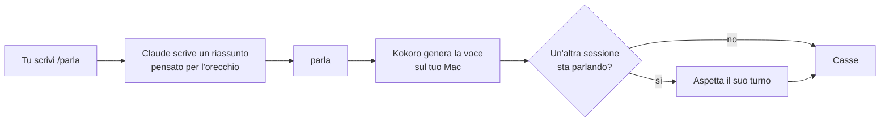

# claude-parla

> Claude Code ti riassume a voce l'ultima risposta. Solo quando glielo chiedi.


Scrivi `/parla` dopo una risposta e la senti riassunta in mezzo minuto, con una voce italiana che nasce sul tuo Mac.
Non ti legge tutto il testo parola per parola: ti dice quello che conta.

La voce non sostituisce la lettura. C'è quando leggere non ti va.

**Perfetto per:**

- dare tregua agli occhi dopo ore di schermo;
- tenere d'occhio più sessioni di Claude Code senza rileggerle tutte;
- sentire com'è andata mentre ti alzi a prendere un caffè;
- risposte lunghe di cui ti serve solo il succo.

## Guardalo in azione

Una domanda vera a Claude Code, poi `/parla`:

```text
> Come si prepara un buon caffè con la moka? Dammi i passaggi con le dosi,
  e dimmi se conviene pressare il caffè nel filtro.

  (Claude risponde: sette passaggi, una tabella di dosi, tre motivi per non pressare,
   come pulirla. Quasi quattrocento parole.)

> /parla

  Bash  parla <<'FINE_PARLA'
        Caffè con la moka. Il filtro non si pressa: si riempie fino all'orlo e si
        livella, altrimenti il caffè esce amaro e può scattare la valvola. Acqua nella
        caldaia fino a poco sotto la valvola, meglio se già calda. Per una moka da tre
        tazze servono circa centocinquanta millilitri d'acqua e quindici o sedici
        grammi di caffè. Fuoco basso, togli al primo gorgoglio e mescola prima di versare.
        FINE_PARLA
```

[▶ Ascolta come suona (20 secondi, voce Sara)](assets/esempio.mp3)

Sessantotto parole al posto di quasi quattrocento. Il «non si pressa», i 150 millilitri e i 15-16 grammi della tabella restano esatti.

## Avvio rapido

**Ti servono:** un Mac con chip Apple (M1 o successivi), [Claude Code](https://claude.com/claude-code) e [uv](https://docs.astral.sh/uv/).

```bash
git clone https://github.com/ilGionny/claude-parla.git
cd claude-parla
./install.sh
```

Poi apri una nuova sessione di Claude Code e, dopo una risposta, scrivi:

```text
/parla
```

La prima installazione scarica la voce una volta sola (circa 330 MB). Alla fine Sara ti dice che è tutto pronto.

## Come si usa

| scrivi | succede |
|---|---|
| `/parla` | Riassunto dell'ultima risposta in 3-5 frasi, circa mezzo minuto |
| `/parla più corto` | Due o tre frasi, solo l'essenziale |
| `/parla solo la decisione` | Ti dice cosa devi decidere tu |
| `/parla con tutti i numeri` | Più dettaglio sulle cifre |

Qualsiasi indicazione dopo `/parla` viene seguita. Per fermare la voce, premi **Esc**.

## Come funziona



1. `/parla` è una skill di Claude Code: gli dice come scrivere il riassunto.
2. Claude passa il testo a `parla`, un piccolo script.
3. `parla` genera l'audio con [Kokoro](https://huggingface.co/hexgrad/Kokoro-82M) tramite [mlx-audio](https://github.com/Blaizzy/mlx-audio), sul tuo Mac, e lo suona. Se un'altra sessione sta già parlando, aspetta la fine.

## Caratteristiche

- **Solo a comando.** Niente automatismi: se non scrivi `/parla`, non cambia niente.
- **La voce nasce sul tuo Mac.** Nessun servizio a pagamento, nessun audio che esce dal computer.
- **Scritto per l'orecchio.** Niente elenchi, simboli o link letti ad alta voce. Le sigle e le parole inglesi vengono scritte come si pronunciano.
- **Fedele.** I numeri che contano, i «non» e i «se» restano esatti. Si arrotonda solo quando non cambia niente.
- **Più sessioni, una voce alla volta.** Con sei sessioni aperte non si parlano sopra. E ogni riassunto comincia dicendo di cosa parla.
- **Non tocca le tue impostazioni.** Nessun hook, `settings.json` resta com'è. Installa tre cose, elencate sotto in «Disinstallare».
- **Mai un audio a metà.** Se una frase è troppo lunga per la voce, `parla` non la legge tagliata: lo dice, e Claude riprova con frasi più corte.

## Personalizza

Aggiungi queste righe al tuo `~/.zshrc` e apri una nuova sessione:

```bash
export PARLA_VOCE=im_nicola     # voce maschile; quella di partenza è if_sara
export PARLA_VELOCITA=1.2       # 1.0 normale, 1.2 più svelta, 0.9 più calma
```

**Lingue.** L'installazione copre l'italiano, con Sara e Nicola. Kokoro ha anche voci in altre lingue, ma richiedono componenti in più (per l'inglese, `misaki[en]`) e non sono state provate qui.

## Perché non AgentVibes o VoiceMode?

Sono due progetti ottimi e più ricchi di questo. Fanno un'altra cosa.

| | claude-parla | [AgentVibes](https://github.com/paulpreibisch/AgentVibes) | [VoiceMode](https://github.com/mbailey/voicemode) |
|---|---|---|---|
| Quando parla | Solo quando scrivi `/parla` | Quando è attivo, a ogni richiesta: all'inizio e alla fine del lavoro | Quando avvii una conversazione a voce |
| Cosa dice | Un riassunto di 3-5 frasi | Due frasi brevi, fino a 150 caratteri | Quello che Claude sceglie di dirti mentre parlate |
| Microfono | No | No | Sì: parli tu e risponde lui |
| Impostazioni | Non tocca `settings.json` | Aggiunge hook globali | Il plugin aggiunge hook con suoni in ogni sessione |
| È fatto per | Sentire il succo, a comando | Una narrazione continua del lavoro | Lavorare a mani libere |

Se vuoi parlare con Claude senza tastiera, VoiceMode è la scelta giusta.

## Risoluzione problemi

| problema | soluzione |
|---|---|
| `/parla` non compare | Apri una nuova sessione: le skill si caricano all'avvio |
| `parla: motore voce non trovato` | Rilancia `./install.sh` |
| Claude chiede il permesso per `parla` | Una tua regola `ask` o `deny` prevale sulla skill. Aggiungi `Bash(parla *)` alle regole `allow` |
| `frase troppo lunga` | Claude riprova da solo con frasi più corte. Se usi `parla` dal terminale, spezza il testo in frasi |
| Non si sente niente | Controlla volume e uscita audio, poi prova `parla "prova"` nel terminale |
| `~/.local/bin non è nel PATH` | Aggiungi `export PATH="$HOME/.local/bin:$PATH"` al tuo `~/.zshrc` |
| `percorso troppo lungo per eSpeak` | Succede solo con nomi utente molto lunghi. Apri una issue |

## Prove

```bash
./prove.sh
```

Sette prove, e suonano davvero: testo con caratteri difficili, voce sbagliata, frase troppo lunga, due sessioni insieme, fermata in tre momenti diversi.

## Disinstallare

```bash
rm -rf ~/.local/share/claude-parla ~/.claude/skills/parla ~/.local/bin/parla
```

La voce scaricata sta in `~/.cache/huggingface/hub/models--mlx-community--Kokoro-82M-bf16`: cancellala se non la usi per altro.

## Crediti

- [mlx-audio](https://github.com/Blaizzy/mlx-audio) di Prince Canuma: fa girare la voce sui chip Apple.
- [Kokoro](https://huggingface.co/hexgrad/Kokoro-82M) di hexgrad: la voce, licenza Apache 2.0.
- [VoiceMode](https://github.com/mbailey/voicemode), [AgentVibes](https://github.com/paulpreibisch/AgentVibes) e [claude-code-tts](https://github.com/melderan/claude-code-tts): studiati prima di scrivere una riga. L'idea della fila tra le sessioni viene da claude-code-tts.

## Licenza

MIT. Vedi [LICENSE](LICENSE).

## Chi l'ha fatto

Gionata Capasso. Scrivimi su [LinkedIn](https://www.linkedin.com/in/gionata-capasso-b452ab18a/) se lo usi, se si rompe o se hai un'idea.

---

## In English

**claude-parla** is a Claude Code skill that reads you a short spoken summary of Claude's last answer, only when you type `/parla`.
The voice (Kokoro via mlx-audio) runs locally on your Apple Silicon Mac. No hooks, no settings changes, and several sessions never talk over each other.
It is tuned for Italian (voices Sara and Nicola); other Kokoro languages need extra packages and are untested.

```bash
git clone https://github.com/ilGionny/claude-parla.git && cd claude-parla && ./install.sh
```
